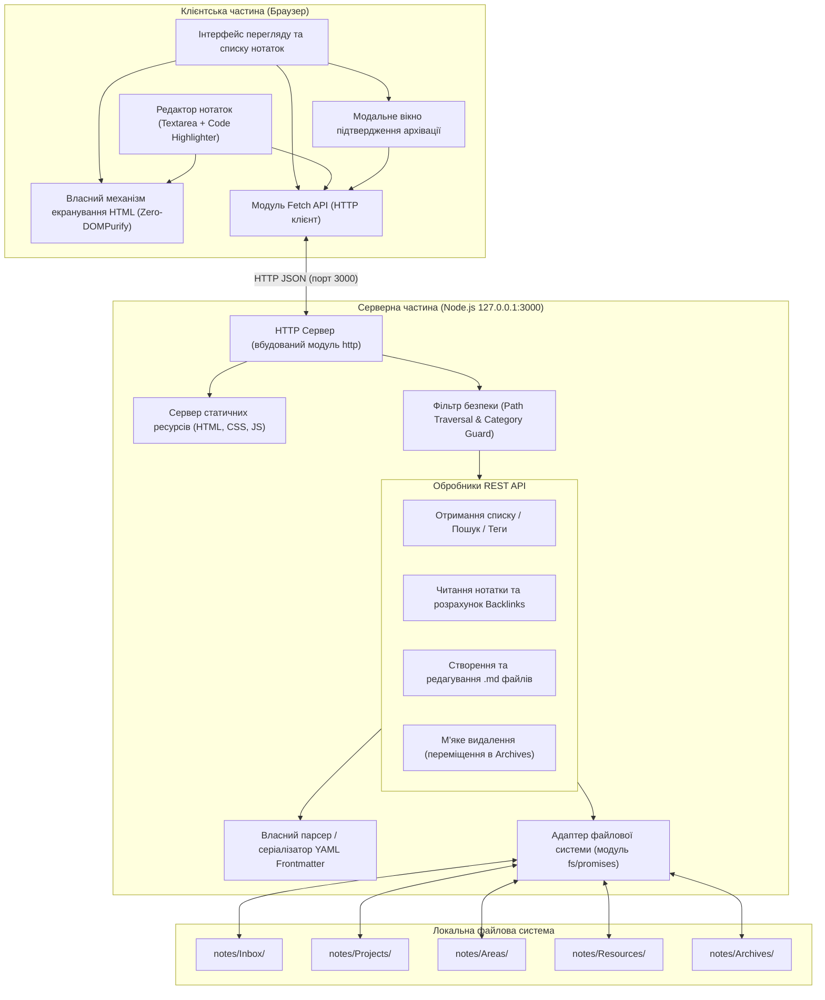

# Архітектура персонального Second Brain

Цей документ фіксує узгоджену системну архітектуру локального навчального «Second Brain» для студента. Система оптимізована для швидкого ведення конспектів, переходу за зв'язками між темами та повної автономності без зовнішніх залежностей.

---

## 1. Загальний огляд і системні принципи

- **Zero-Dependency Backend**: Сервер працює на чистому середовищі Node.js із використанням лише вбудованих модулів (`http`, `fs`, `path`). Жодних сторонніх пакетів з `npm`.
- **Local-First & Flat Markdown**: Усі дані зберігаються виключно у вигляді `.md` файлів із YAML frontmatter у папці `notes/`, без використання баз даних.
- **Організація за PARA**: Структурування інформації здійснюється за п'ятьма категоріями: `Inbox`, `Projects`, `Areas`, `Resources`, `Archives`.
- **Локальна мережева ізоляція**: Сервер приймає з'єднання виключно на інтерфейсі зворотного зв'язку `127.0.0.1:3000`.
- **Zero-DOMPurify XSS Protection**: Захист від XSS-ін'єкцій реалізується власним алгоритмом екранування небезпечних HTML-сутностей без додавання зовнішніх бібліотек.
- **Зовнішній AI-контур**: Сам застосунок не містить коду LLM чи зовнішніх API-викликів; сортування та тегування здійснюється за запитом через Antigravity Agent Skill безпосередньо у файловій системі.

---

## 2. Компонентна архітектура (C4 Component Diagram)



---

## 3. Потоки даних (Data Flows)

### 3.1. Перегляд нотатки та генерація зворотних посилань (Backlinks)
1. Користувач обирає нотатку в інтерфейсі.
2. Клієнт надсилає запит: `GET /api/notes/:category/:filename`.
3. Сервер через `SecurityGuard` перевіряє безпеку параметрів шляху.
4. Сервер зчитує файл, вилучає YAML frontmatter та тіло Markdown.
5. Сервер виконує швидкий перебір усіх файлів у каталозі `notes/`, відбираючи нотатки, які містять рядок `[[ПоточнаНазва]]` або `[[поточний_slug]]`.
6. Сервер повертає JSON із метаданими, контентом та масивом `backlinks`.
7. Клієнтський власний санітизатор екранує сирий HTML, рендерить базовий Markdown, підсвічує блоки коду, замінює конструкції `[[Назва]]` на активні клікабельні посилання і виводить список знайдених Backlinks у підвалі нотатки.

### 3.2. М'яке видалення (Soft Delete / Архівація)
1. Користувач натискає іконку видалення в інтерфейсі.
2. Інтерфейс викликає модальне вікно або системне підтвердження: *«Перемістити нотатку в Archives?»*.
3. При підтвердженні надсилається запит: `DELETE /api/notes/:category/:filename`.
4. Сервер перевіряє категорію та назву файлу через `SecurityGuard`.
5. Сервер зчитує файл, змінює значення поля `status` на `archived` та оновлює мітку `updated`.
6. Сервер атомарно переміщує файл за допомогою `fs.rename` із поточної категорії до `notes/Archives/:filename`.
7. Фізичного видалення даних із диска не відбувається.

### 3.3. Взаємодія з Antigravity Agent Skill
1. Студент зберігає неструктуровані конспекти з пар у папку `notes/Inbox/`.
2. За командою користувача Antigravity Agent Skill відкриває каталог `notes/Inbox/`.
3. Агент аналізує навчальний контекст, підбирає нормалізовані теги (`tags: [...]`) та визначає кінцеву категорію (наприклад, `notes/Areas/`).
4. Агент перезаписує YAML-метадані та переміщує файл у цільову папку.
5. При черговому запиті списку нотаток вебзастосунок відображає оновлену структуру.

---

## 4. Специфікація моделі нотатки

Кожна нотатка зберігається у форматі `.md` і обов'язково містить валідний блок YAML Frontmatter на початку файлу.

### Схема полів метаданих
| Поле | Тип | Опис | Приклад значення |
| :--- | :--- | :--- | :--- |
| `title` | `string` | Людинозрозуміла назва нотатки | `"Структурні конфлікти конвеєра"` |
| `created` | `string` | Дата створення у форматі YYYY-MM-DD | `"2026-11-01"` |
| `updated` | `string` | Дата останнього збереження YYYY-MM-DD | `"2026-11-01"` |
| `type` | `string` | Тип навчального матеріалу (`lecture`, `lab`, `seminar`, `concept`, `literature`) | `"lecture"` |
| `status` | `string` | Життєвий цикл (`inbox`, `in_progress`, `completed`, `archived`) | `"in_progress"` |
| `tags` | `array` | Список тегів у нижньому регістрі | `["аскс", "процесори", "конвеєр"]` |
| `source` | `string` | Посилання на джерело або репозиторій | `"Лекція №3, слайд 14"` |

### Приклад файлу нотатки
```markdown
---
title: "Структурні конфлікти конвеєра"
created: "2026-11-01"
updated: "2026-11-01"
type: "lecture"
status: "in_progress"
tags:
  - "аскс"
  - "процесори"
source: "Курс АСКС 7 семестр"
---

# Структурні конфлікти конвеєра

Виникають, коли дві інструкції намагаються одночасно використати один і той самий апаратний ресурс.

```c
// Затримка (bubble/stall) конвеєра
void insert_bubble(Pipeline *p) {
    p->stage_id.nop = true;
}
```

Див. також: [[Методи усунення конфліктів]].
```

---

## 5. Специфікація REST API та захист від атак

Сервер слухає виключно `http://127.0.0.1:3000`.

### 5.1. Захист від Path Traversal (Security Invariants)
Будь-який запит, що містить параметри `:category` та `:filename`, валідується за такими правилами:
1. `category` повинна суворо належати білому списку дозволених папок:
   `["Inbox", "Projects", "Areas", "Resources", "Archives"]`.
2. `filename` перевіряється на заборонені послідовності:
   - Не містить `..`
   - Не містить символів розділювачів шляхів `/` або `\`
   - Обов'язково закінчується на `.md`
   - Містить лише безпечні символи (літери, цифри, дефіс, підкреслення).
3. При порушенні будь-якого правила сервер негайно повертає `400 Bad Request` із кодом помилки `INVALID_PATH`.

### 5.2. Ендпоінти

| Метод | Шлях | Опис | Тіло запиту / відповіді |
| :--- | :--- | :--- | :--- |
| `GET` | `/` або `/public/*` | Віддача статичних файлів | Віддає `index.html`, `style.css`, `app.js`. |
| `GET` | `/api/notes` | Отримання списку нотаток | Query-параметри: `?search=текст`, `?tag=тег`, `?category=папка`. Повертає масив об'єктів метаданих. |
| `GET` | `/api/notes/:category/:filename` | Читання нотатки | Повертає `{ metadata, content, backlinks: [...] }`. |
| `POST` | `/api/notes` | Створення нової нотатки | Тіло: `{ title, category, type, status, tags, source, content }`. Створює файл у відповідній папці. |
| `PUT` | `/api/notes/:category/:filename` | Оновлення нотатки | Тіло: `{ title, category, type, status, tags, source, content }`. Оновлює файл та змінює `updated`. |
| `DELETE` | `/api/notes/:category/:filename` | М'яке видалення (архівація) | Не видаляє файл фізично. Переміщує у `notes/Archives/` та оновлює `status: "archived"`. |

---

## 6. Критерії приймання (Acceptance Criteria)

- **AC-1 (Zero-Dependencies):** Файл `package.json` не містить секції `dependencies`. Проєкт запускається командою `npm start` засобами стандартного Node.js на `127.0.0.1:3000`.
- **AC-2 (Path Traversal Protection):** Спроби запитів типу `GET /api/notes/../../etc/passwd` або `DELETE /api/notes/Inbox/..%2Fserver.js` блокуються з кодом `400 Bad Request`.
- **AC-3 (Soft Delete with Confirmation):** 
  - Натискання на видалення викликає модальний діалог підтвердження.
  - Після підтвердження файл фізично переміщується у директорію `notes/Archives/`.
  - У метаданих файлу статус замінюється на `archived`.
- **AC-4 (Власне екранування HTML):** 
  - Заборонено використання зовнішньої бібліотеки `DOMPurify`.
  - Власний алгоритм виконує екранування спеціальних символів (`<`, `>`, `&`, `"`, `'`) перед формуванням HTML-розмітки.
  - Блоки коду коректно відображаються із підсвіткою синтаксису без виконання вбудованого коду.
- **AC-5 (Двосторонні посилання):**
  - Будь-яке входження `[[Назва]]` перетворюється на клікабельне посилання, що відкриває відповідну нотатку.
  - У перегляді нотатки відображається список зворотних посилань (*Backlinks*).
- **AC-6 (Лінійний пошук і теги):**
  - Пошук здійснюється перебором файлів на сервері без сторонніх індексів чи БД.
  - Можлива одночасна фільтрація за тегом та входженням підрядка в назву або текст.

---

## 7. Ризики та заходи безпеки (Risk Matrix & Mitigation)

| Ризик | Ступінь | Заходи пом'якшення |
| :--- | :--- | :--- |
| **Path Traversal (Вихід за межі notes/)** | Критичний | Жорсткий білий список категорій (`Inbox`, `Projects`, `Areas`, `Resources`, `Archives`), перевірка розширення `.md`, блокування `..`, `/`, `\`. |
| **XSS через конспекти з чужих джерел** | Високий | Власне обов'язкове екранування HTML-сутностей усім текстом до моменту побудови DOM, сувора заборона виконання сирих скриптів. |
| **Випадкова втрата важливих навчальних даних** | Високий | Відсутність фізичного `DELETE` на диску. Будь-яке видалення є переміщенням у `notes/Archives/` із попереднім підтвердженням користувача. |
| **Несанкціонований доступ із локальної мережі (LAN)** | Середній | Прив'язка HTTP-сервера виключно до `127.0.0.1` (localhost), що унеможливлює підключення інших пристроїв у тій самій Wi-Fi мережі гуртожитку чи університету. |
| **Витік конфіденційних нотаток або секретів у Git** | Середній | Налаштований `.gitignore`. Створення навчальних інструкцій у `README.md` щодо ізоляції чутливих конспектів і ручного бекапу. |
